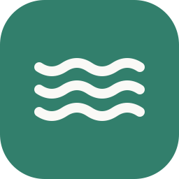
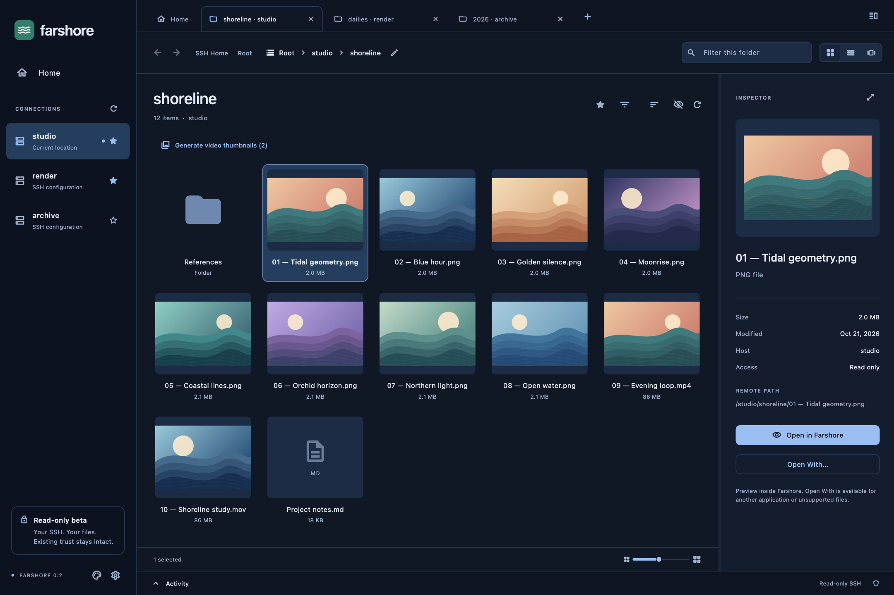
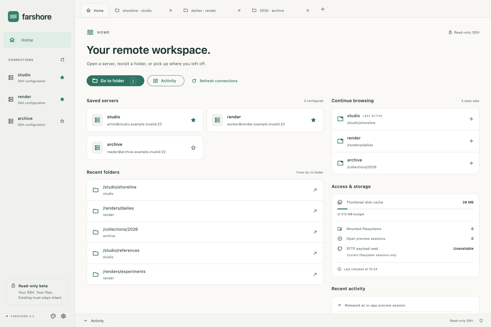
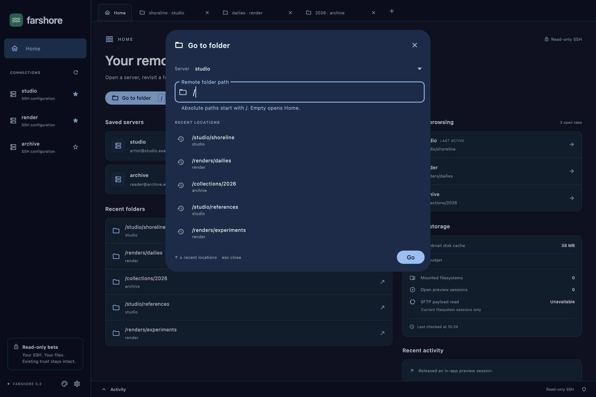
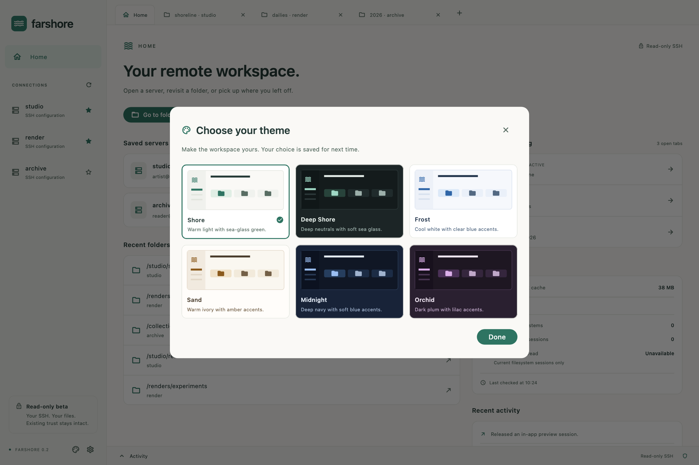
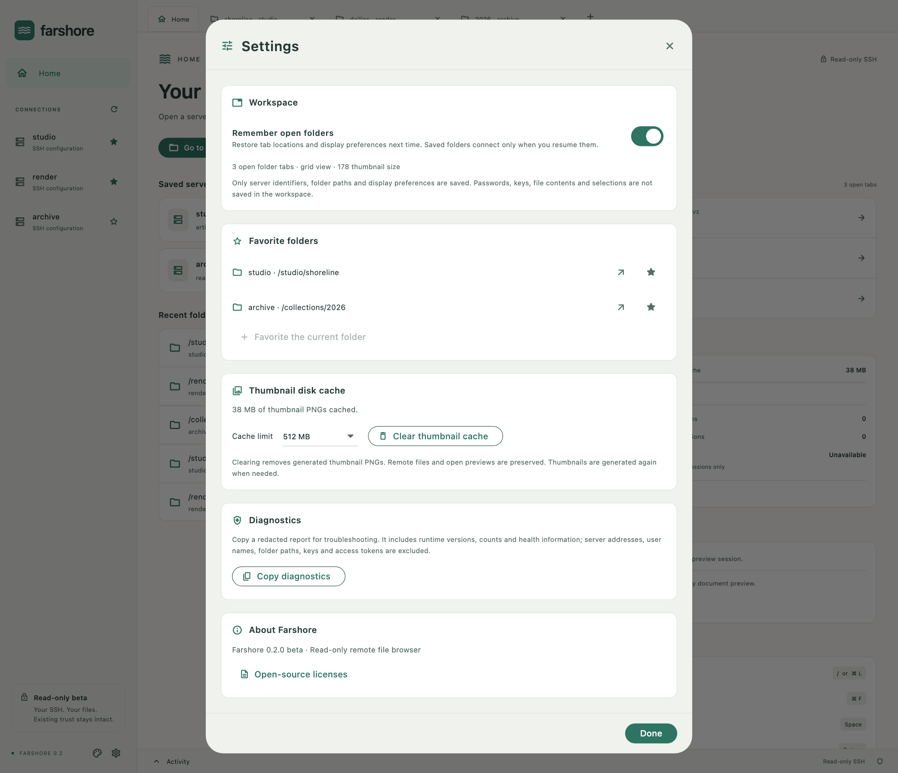

<p align="center">
  
</p>
<h1 align="center">Farshore</h1>
<p align="center"><strong>Your remote files. A little closer.</strong><br>A read-only SSH file browser for macOS.</p>
<p align="center">
  <a href="https://github.com/Awaisryk/farshore/releases">Download the beta</a> ·
  <a href="#screenshots">Screenshots</a> ·
  <a href="#build-from-source">Build from source</a> ·
  <a href="https://github.com/Awaisryk/farshore/issues">Report an issue</a>
</p>
<p align="center">
  <a href="https://github.com/Awaisryk/farshore/actions/workflows/ci.yml"></a>
  &nbsp; Apple Silicon · macOS · MIT
</p>



Farshore brings a visual workspace to the SSH connections you already use. Browse images and videos, jump straight to a remote path, preview common files, and return to your saved folders. Your existing SSH configuration, authentication and host-key trust stay in charge. No software needs to be installed on the server.

**This is a read-only beta.** The downloadable app is ad hoc signed and **not notarized**, so macOS may block a downloaded copy. Apple Silicon macOS 26.4 has been validated locally; GitHub CI also checks the build and runtime on macOS 15. Full older-system and Intel acceptance remains open. [See the remaining release gates →](docs/production-readiness.md)

## Made for your remote workspace

| | What you can do |
| --- | --- |
| **Browse visually** | Switch between grid, list and gallery; resize thumbnails, filter names, sort files and inspect details. |
| **Jump anywhere** | Press `/` for the path launcher. Open SSH Home, `/`, `/data`, `/data2` or any path your account can read. Revisit five recent destinations across servers. |
| **Keep useful places close** | Favorite servers and folders. Restore up to 32 folder tabs, the active location, view, density, sort and inspector choices. Saved tabs connect when you resume them. |
| **Preview inside the app** | View common images, PDFs, Office documents and selectable text. Stream audio/video through an installed official VLC 3 application. Open With stays available. |
| **Fill the gallery** | Generate video thumbnails for the entire listed folder, with progress, cancellation and retry. Visible previews take priority; playback pauses background generation. |
| **Make it yours** | Choose Shore, Deep Shore, Frost, Sand, Midnight or Orchid. Themes apply across Home, the browser, dialogs and playback controls. |
| **Stay in control** | Set the thumbnail cache budget, clear generated thumbnails and copy redacted diagnostics. Interrupted folder reads have bounded retries and a Cancel action. |

## Screenshots

These images render Farshore's actual interface with sample servers, sample paths and generated demo artwork. They contain no private connections or user files. Click an image to see it at full size.

<table>
  <tr>
    <td width="50%"><a href="docs/images/home-shore.png"></a><br><strong>A useful Home.</strong> Servers, recent folders, open tabs and local storage in one place.</td>
    <td width="50%"><a href="docs/images/path-launcher.png"></a><br><strong>One shortcut to anywhere.</strong> Type a path or return to a recent destination.</td>
  </tr>
  <tr>
    <td width="50%"><a href="docs/images/themes.png"></a><br><strong>Six workspace themes.</strong> Preview a palette and keep browsing.</td>
    <td width="50%"><a href="docs/images/settings.png"></a><br><strong>Settings that matter.</strong> Saved folders, cache limits, cleanup and diagnostics.</td>
  </tr>
</table>

## Install

**[Download Farshore 0.2.0 beta for Apple Silicon](https://github.com/Awaisryk/farshore/releases/download/v0.2.0-beta.1/Farshore-0.2.0-macos-arm64-beta.zip)** · about 61 MiB · [checksums](https://github.com/Awaisryk/farshore/releases/download/v0.2.0-beta.1/SHA256SUMS)

1. Download `Farshore-0.2.0-macos-arm64-beta.zip` from [Releases](https://github.com/Awaisryk/farshore/releases). Use the accompanying `SHA256SUMS` to verify it.
2. Unzip it and move `Farshore.app` to Applications.
3. Open Farshore and choose an alias from your existing SSH configuration.

The app bundles Python, rclone and its native helper. A checkout, Flutter, Homebrew and Xcode are unnecessary to run it. You need an SSH connection that already works with verified host keys and noninteractive authentication. Unknown or changed host identities stop access; Farshore does not weaken SSH trust settings.

An **official VLC 3 installation** enables internal audio/video playback. Other previews and external opening work without VLC. Supported document variants depend on macOS Quick Look providers; unsupported files retain an explicit Open With choice.

For upgrades, quit the old app and replace its bundle. Preferences and cached thumbnails stay in your Library folders. [Installation, rollback and development-state migration →](docs/releases.md)

## A few shortcuts

| Shortcut | Action |
| --- | --- |
| `/` | Open the global path launcher, outside text fields |
| `⌘L` | Go to a folder |
| `⌘F` | Filter the current folder |
| `⌘T` | Open a new tab |
| `⌘R` | Refresh the current folder |
| `Space` | Quick preview |
| `Return` | Open the selected file |

## Your files and local data

Remote access stays read-only. Farshore does not expose rename, delete, upload, remote editing or explicit transfer controls in this beta. Authentication remains with existing OpenSSH tooling. No telemetry, automatic crash upload or automatic updater is enabled.

| Local data | Location |
| --- | --- |
| Preferences, workspace, favorites and retained-session metadata | `~/Library/Application Support/Farshore` |
| Generated thumbnail PNGs | `~/Library/Caches/Farshore/thumbnails` |
| Temporary document snapshots | Private `previews` directory in Application Support; removed after acknowledged close or stale-owner cleanup |

Settings supports a **128 MiB–2 GiB** thumbnail budget. Clearing it removes completed thumbnail PNGs while preserving preferences, open previews and external sessions. Document snapshots are bounded: up to 64 MiB per image, 32 MiB per document or the first 512 KiB of text; truncated text is labeled. Audio/video stream instead of requiring a complete local copy.

External opening uses an experimental loopback NFS bridge. Cold reads can stall, and other local processes can access the loopback export. Internal playback uses a scoped, token-protected range endpoint instead. Close external readers before ejecting their mounted volumes in Finder. [Access model and validation limits →](docs/production-readiness.md)

## Build from source

You need an Apple Silicon Mac, Git and Apple's **Command Line Tools**. Full Xcode, CocoaPods and `xcodebuild` are not required by this build path.

```sh
git clone https://github.com/Awaisryk/farshore.git
cd farshore
scripts/bootstrap.sh
scripts/build-app.sh --release
open build/Farshore.app
```

The scripts pin and verify dependencies, build an optimized Flutter AOT interface and Swift host, assemble the standalone runtime, and sign the bundle ad hoc. Use `--debug` only for debugging; release AOT is the default. Existing running bundles are preserved during rebuilds.

<details>
<summary><strong>Run the checks</strong></summary>

```sh
export FLUTTER_SUPPRESS_ANALYTICS=true
.tools/flutter/bin/flutter --no-version-check analyze
.tools/flutter/bin/flutter --no-version-check test
python3 -m unittest discover -s tests -v
python3 scripts/test-portable-app.py build/Farshore.app
scripts/test-native-accessibility.sh build/Farshore.app --home
```

The current validation includes **151 Flutter tests**, **73 backend/packaging tests**, clean analysis, a relocated standalone-runtime check, and native accessibility, document-preview, playback and signature checks. Full multi-gigabyte media, sleep/wake, older-system and clean Gatekeeper download acceptance remain open.

Documentation screenshots can be regenerated with `scripts/capture-readme.sh`; the [image notes](docs/images/README.md) describe the sample data.

See [technical validation](docs/technical-validation.md) for measured results and limits. [Portable packaging](docs/portable-package.md) explains runtime provenance, migration, signing and notarization.

</details>

## Project notes

- [Product requirements](PRD.md) — intended product and wider acceptance criteria.
- [Implementation status](docs/implementation-status.md) — what works and what remains.
- [Engineering decisions](docs/decisions.md) — SSH, previews, caching and lifecycle choices.
- [Dependency inventory](docs/dependencies.md) — pinned versions, upstream sources and notices.
- [Production readiness](docs/production-readiness.md) — the remaining distribution gates.

Found a problem? Use Settings → Copy diagnostics, review the redacted report, and [open an issue](https://github.com/Awaisryk/farshore/issues). Include the app/macOS versions and steps to reproduce. Keep private keys, SSH configuration, private file listings and unrestricted logs out of public reports.

## License

Farshore's source is available under [MIT](LICENSE). Bundled dependencies retain their own licenses and notices; these are available in Settings → Open-source licenses and in the app's Resources directory. VLC is independently installed and is not redistributed.

The release also includes a [corresponding-source kit for rclone](https://github.com/Awaisryk/farshore/releases/download/v0.2.0-beta.1/Farshore-0.2.0-rclone-corresponding-source.zip), including LGPL/MPL components, an offline module proxy, and rebuild/replacement instructions. That optional source download is unnecessary to run Farshore.
